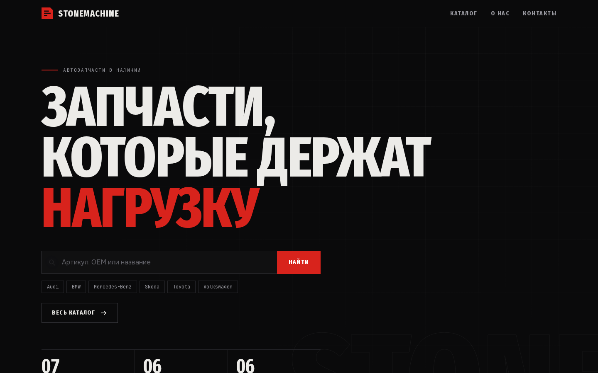
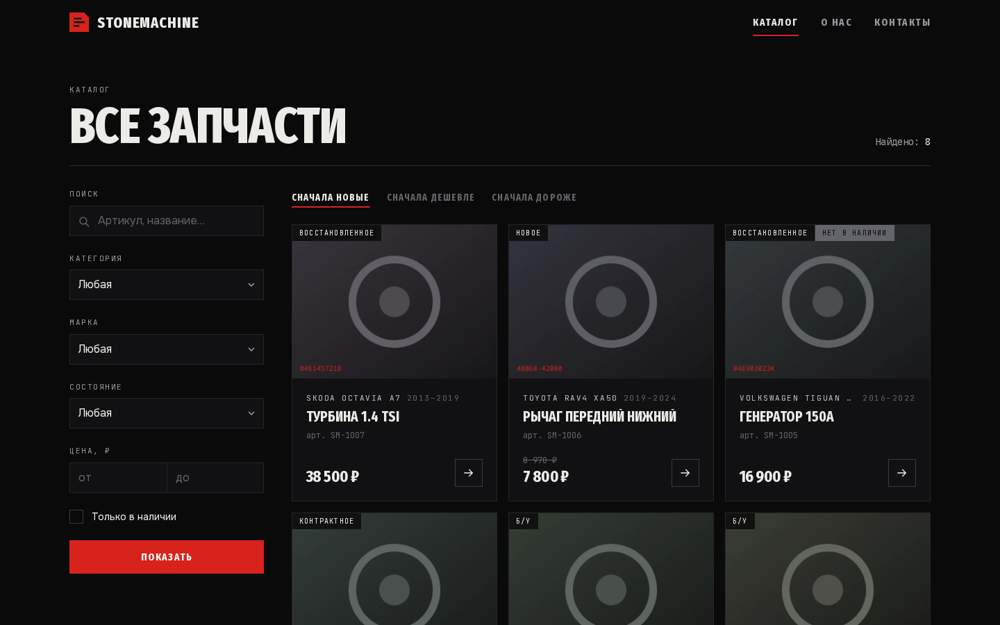
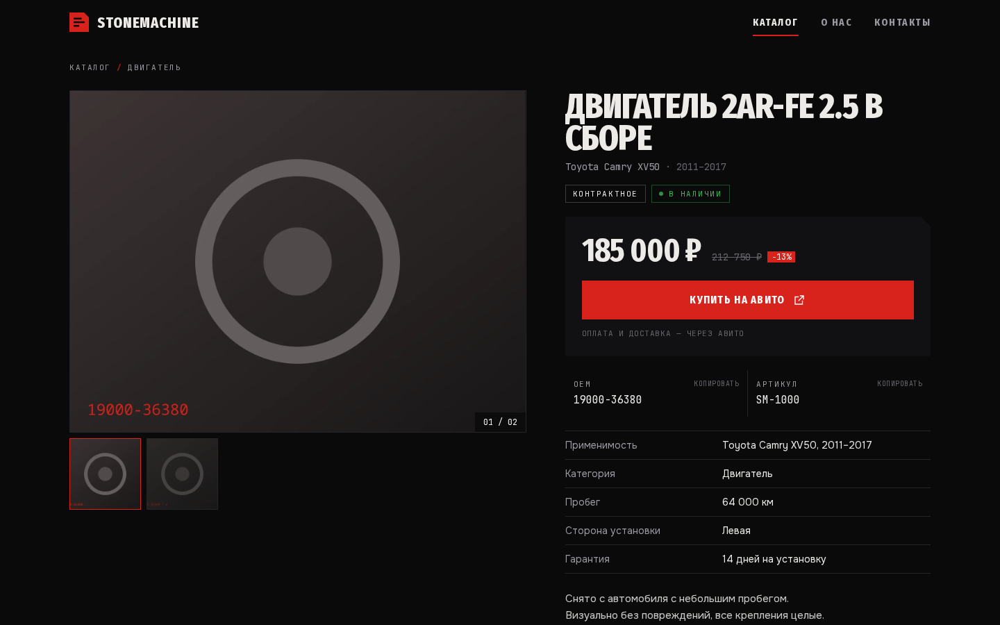
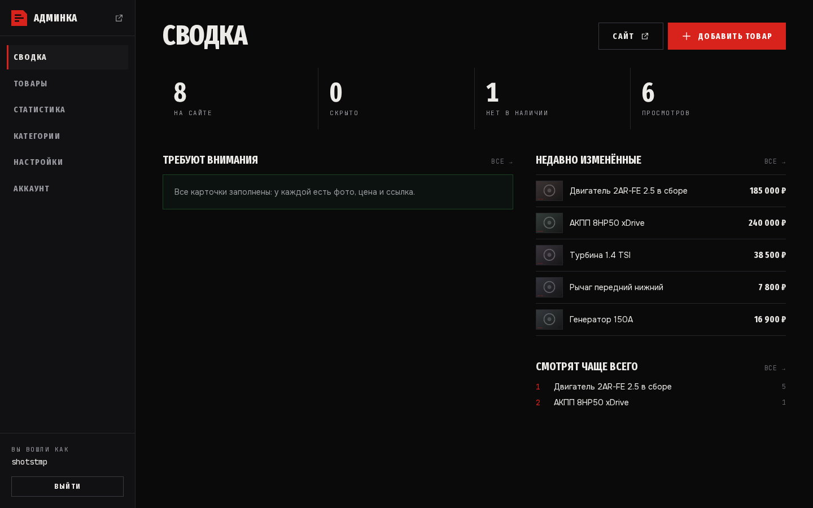
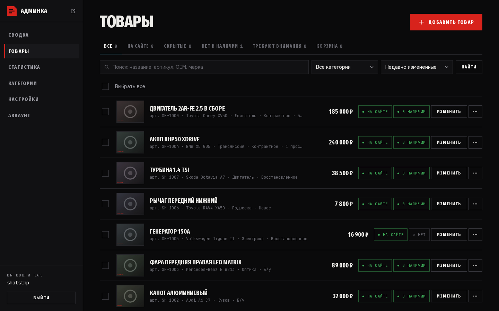
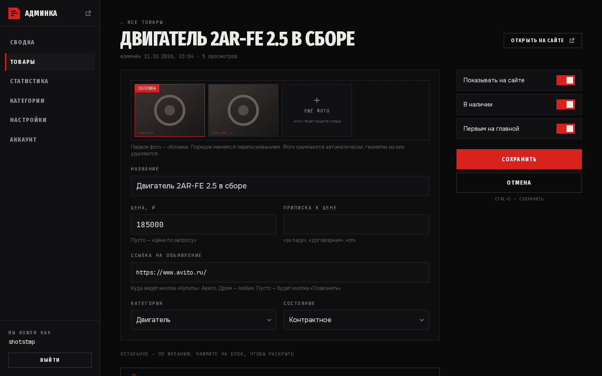
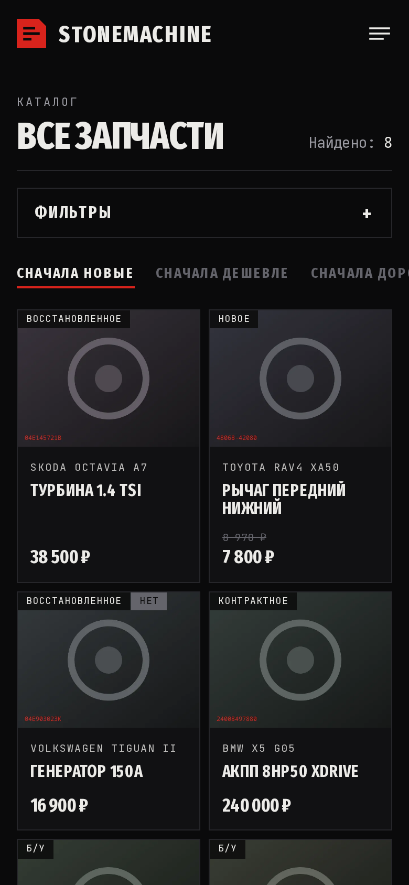

<div align="center">

# STONEMACHINE

**Сайт-витрина автозапчастей с закрытой админкой**
Покупатель выбирает деталь на сайте — покупает по ссылке на Авито.




</div>

---

## О проекте

Небольшой магазин разбирает автомобили и продаёт запчасти на Авито. Авито — это объявления без своего лица и без нормального каталога. **STONEMACHINE** — собственная витрина: бренд, фильтры по марке, категории и состоянию, поиск по артикулу и OEM, а оплата и доставка по-прежнему идут через Авито.

Главное требование к проекту — **владелец заполняет каталог сам и без разработчика**. Поэтому админка сделана как рабочий инструмент: одна обязательная графа в карточке, массовые действия, корзина на 30 дней и деплой одной командой.

> Дизайн — тёмный индустриальный: плотная сетка, узкий гротеск, сигнальный красный.
> Данные на скриншотах — демо-товары.

## Скриншоты

<table>
  <tr>
    <td width="50%"><br><sub><b>Каталог</b> — фильтры по категории, марке, состоянию и цене, сортировка</sub></td>
    <td width="50%"><br><sub><b>Карточка товара</b> — галерея, OEM и артикул с копированием, кнопка «Купить на Авито»</sub></td>
  </tr>
  <tr>
    <td width="50%"><br><sub><b>Сводка</b> — что на сайте, что требует внимания, что смотрят чаще всего</sub></td>
    <td width="50%"><br><sub><b>Товары</b> — переключатели «На сайте» и «В наличии» в один клик, массовые действия</sub></td>
  </tr>
  <tr>
    <td width="50%"><br><sub><b>Карточка в админке</b> — перетаскивание фото, Ctrl+S, обязательно только название</sub></td>
    <td width="50%" align="center"><br><sub><b>Мобильная версия</b></sub></td>
  </tr>
</table>

## Возможности

<table>
  <tr>
    <td width="33%" valign="top">

### 🔎 Витрина
Каталог с поиском по артикулу, OEM и названию. Фильтры по марке, категории, состоянию, цене и «только в наличии». Карточка с применимостью, характеристиками и произвольными разделами.

</td>
    <td width="33%" valign="top">

### 🛠 Админка
Сводка, товары, категории, статистика просмотров, настройки, смена пароля. Массовые действия, корзина на 30 дней, «Сохранить и добавить ещё», горячая клавиша Ctrl+S.

</td>
    <td width="33%" valign="top">

### 🖼 Фото без забот
Фото перетаскиваются мышкой. Сервер перекодирует их в WebP двух размеров, чинит ориентацию и **вырезает EXIF** — геометки с телефона не уходят на сайт.

</td>
  </tr>
  <tr>
    <td valign="top">

### 📈 SEO из коробки
Карта сайта и `robots.txt` собираются из базы. JSON-LD разметка товаров, Open Graph, подтверждение Яндекса и Google из админки, уведомление **IndexNow** при каждом изменении.

</td>
    <td valign="top">

### 🔐 Безопасность
Пароли — Argon2, сессии с подписью, выход со всех устройств, ограничение частоты попыток входа.

</td>
    <td valign="top">

### 🚀 Деплой одной командой
`./deploy.sh` по SSH ставит nginx, PostgreSQL и Node.js, заливает код, создаёт базу и админа. Повторный запуск — обновление: товары и фото не теряются. Сертификат выпускает certbot.

</td>
  </tr>
</table>

## Стек

| Слой | Технологии |
|---|---|
| Фронтенд | Next.js 15 (App Router, серверные компоненты и Server Actions), React 19, Tailwind CSS 4 |
| Данные | PostgreSQL, Prisma ORM, миграции в `prisma/migrations` |
| Обработка фото | sharp → WebP, удаление EXIF |
| Авторизация | Argon2 (`@node-rs/argon2`), подписанные cookie-сессии |
| Сервер | nginx, systemd, certbot |
| Язык | TypeScript (≈ 4 800 строк) |

## Быстрый старт

Нужны Node.js 22 и PostgreSQL.

```bash
npm install
cp .env.example .env              # поправить DATABASE_URL на свою базу
npx prisma migrate dev            # создать таблицы
npm run db:seed                   # демо-товары и категории
npm run admin:create              # создать админа
npm run dev                       # http://localhost:3000
```

Админка — `http://localhost:3000/admin`.

## Структура

| Где | Что |
|---|---|
| `src/app/(site)` | витрина: главная, каталог, карточка товара |
| `src/app/admin` | админка и все действия (`actions.ts`) |
| `src/app/sitemap.ts`, `robots.txt/` | SEO, собираются из базы |
| `src/lib` | сессии, авторизация, лимиты запросов, загрузка фото, IndexNow |
| `prisma/schema.prisma` | модель данных: категории, товары, фото, админы, настройки, просмотры |
| `deploy.sh` | деплой по SSH |

## Документация

- [Руководство владельца](docs/OWNER_GUIDE.md) — как выложить сайт, заполнять каталог, подключить домен, сделать резервную копию.

## Автор

**Дмитрий Фастовец** ([@charg3d](https://github.com/charg3d)) — дизайн, фронтенд, бэкенд, деплой.
